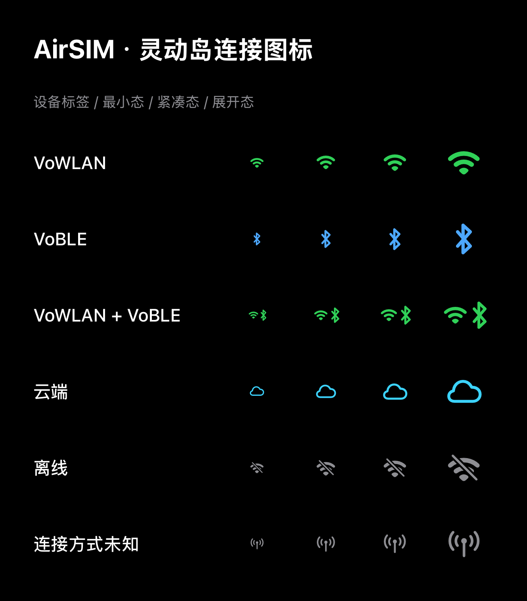

# 灵动岛连接图标 · 2026-11-04

实现位于 `iOS/Shared/AirSIMLiveActivityShared.swift`，由灵动岛最小态、紧凑态、展开态、锁屏状态标记与设备列表复用。

| 连接状态 | 图标 |
| --- | --- |
| VoWLAN | 绿色 Wi-Fi |
| VoBLE | 蓝色蓝牙符号，替换容易误认为扬声器的声波符号 |
| 两条本地链路均在线 | 绿色 Wi-Fi 与蓝牙组合 |
| 云端 | 青色线性云朵 |
| 明确离线 | 灰色 Wi-Fi 斜线 |
| 在线但缺少连接方式 | 灰色天线，不假定为某个模式或离线 |

颜色之外保留不同形状和 VoiceOver 标签。不增加持续动画、额外模糊或玻璃层。云端紧凑态右侧简化为确认符号，离线右侧为横线，避免左右重复展示同一个模式图标。

## 状态约束

图标是展示层派生值，不增加或修改 ActivityKit/APNs 编码字段。明确离线优先于历史在线字段；明确云端路线不会被可用本地链路替换。双通道仅表示两条本地链路均在线，不表示同时使用两条音频路线，也不代表用户连接偏好。未知、缺字段的旧推送仍然兼容。内容过期不推断设备离线。继续使用现有 CallKit 独占通话界面的策略。

## 验证

- Duo iOS 27.2 模拟器：6 项图标状态/渲染测试、10 项活动生命周期回归全部通过。
- ARM64 iOS App 与扩展构建通过；9 个 Mach-O 的 Date 运行时兼容检查通过。
- 图集为生产图标视图在不同尺寸下的实际 SwiftUI 渲染，不是系统灵动岛截图。
- 已将 0.9.8（168）覆盖安装到 iPhone Air 并成功启动，设备查询确认 build 168；未卸载应用。系统岛内排版、真实多活动最小态和 VoiceOver 实机操作仍待用户验收。

