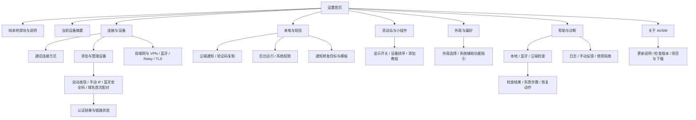

# AirSIM 设置全层级 UI/UX 旅程

2026-11-04 · 基于 VoBLE 工作树现有设置功能整理 · **交互原型；原生设置已按此结构改造，见 [实现与验证](IMPLEMENTATION.md)**。

## 打开与使用

- [可点击原型](index.html)：离线直接打开 HTML 即可，不需要安装依赖。当前会话也可访问 `http://127.0.0.1:8768`。
- 左侧是 44 个页面入口；右侧有 12 条任务旅程和 7 种场景；点击“全部页面”查看全页图集。
- 原型中的配置、配对码、连接结果都是演示值，不访问真实设备、Relay、GitHub 或第三方，不会拨号、发送短信或上传日志。
- [最初高保真方向](concept.png) · [可交互版本总览](prototype-overview.png) · [机器可读页面与旅程](flows.json)。

## 信息架构

**层级约定：** L0 是首页；L1 是六个分类和纯本地说明；L2 是配置与工具；L3 是详情、输入和结果；个别 L4 是配对或模板编辑任务中的下一步。配对入口还可直接从首页设备卡进入。常用开关不埋入高级页，详细参数不占据首页。

## 交互与状态规则

| 场景 | 展示 | 用户动作与结果 |
|---|---|---|
| 首次未配对 | 首页邀请“连接你的安卓手机” | 添加设备 → 选方式 → 权限与一次性码 → 认证 → 控制/音频分别检查 |
| 设备在线 | 设备摘要显示实际链路；连接设置显示用户偏好 | 模式选择成功不伪装成链路已就绪 |
| 安卓离线 | 暂时离线，保留配对记录 | 重新发现 / 手动地址 / 检查；不自动删除凭据 |
| 配对成功但桥未就绪 | 身份通过，音频未就绪 | 指向安卓桥和权限检查，不误报“可通话” |
| 权限拒绝 | 明确是哪项权限缺失 | 打开系统设置指引；真实系统弹窗交给 iOS |
| 正在通话 | 链路、纯本地和域名变更暂不可用 | 解释“通话结束后可修改”，不把当前通话切断 |
| 纯本地已开启 | 顶部状态明确，云端自检/注册/反馈受限 | VPN 与蓝牙直连继续；不把外部 VPN 依赖误认为 Relay |
| 开启纯本地但安卓离线 | 本机已阻断，安卓待同步 | 不宣称跨端同步完成；重连后需核验状态 |
| 同步或保存失败 | 旧设置保留，输入保留 | 用户修正或手动重试；没有静默重试提交 |
| 自检失败 | 已过步骤 / 失败步骤 / 未检查步骤分开 | 展开失败位置，直接进入对应设置；不能用无心跳等同所有链路离线 |
| 反馈上传失败 | 草稿留在页面，错误在提交按钮附近 | 手动重试，不自动上传 |
| 忘记设备 / 清日志 | 说明删除范围的确认面板 | 确认或取消；系统短信、通话记录不被误删 |
| 原始日志导出 | 分享前提醒检查内容 | 原始日志不能统称“已脱敏”；反馈脱敏管线另行处理 |
| Live Activity 到期 | 说明系统时限，避免误报设备离线 | 回前台恢复展示，PushKit / CallKit 独立 |
| 更新检查 | 检查中 / 失败 / 当前渠道 | GitHub 更新不受纯本地限制；TestFlight 与自签渠道需区分 |

**重要约束：**
- 纯本地关闭时，VoWLAN、蓝牙、VoWLAN+VoBLE、自动、云端均允许用户手动云端自检。自检只读检查，不拨号、不发短信。
- 云端通知与通话链路分开；“当前未使用云端通话”不等于 Relay 离线。
- 纯本地开关阻断 AirSIM Relay 相关出口，不声称关闭所有互联网。安卓第三方通知转发独立配置，原型说明其访问第三方服务。
- TLS 公网配对显式标注试验性；不接受明文公网、忽略证书错误或把控制认证当作音频验收。
- 通知转发保留现有 **下次加密配对时同步** 的事实，保存本机后不显示“安卓已生效”。
- 隐私字段使用空的安全输入，不预填真实密码、密钥、Webhook 地址或手机号。
- 表单返回保留草稿；明确取消编辑才放弃。按钮的完成、失败、重试状态就近呈现。

## 十二条端到端旅程

### 1. 日常使用 · 找到常用设置

设置 → 来电与短信 → 灵动岛与小组件 → 外观与偏好

首页只留摘要与入口，长说明按需展开。

### 2. 首次使用 · 自动发现配对

设置 → 连接与设备 → 添加设备 → 发现安卓手机 → 一次性配对 → 配对结果 → Redmi 9

开启安卓配对窗口 → 输入六位码 → 身份认证 → 单独验证网关和音频。

### 3. 外网 / VPN · 手动配对

设置 → 连接与设备 → 添加设备 → 手动地址配对 → 配对结果 → 局域网与 VPN

用安卓 IP 和配对端口；同一隧道不代表所有端口都可达；不需要 Relay。

### 4. 蓝牙 · 双方安全码确认

连接与设备 → 蓝牙连接 → 核对安全码 → 配对结果

设备发现与安全码确认是两步，数字不一致就取消。

### 5. 纯本地 · 开启与限制

设置 → 纯本地模式 → 通话连接方式 → 云端 Relay → 提交反馈

开启即阻断 AirSIM Relay；检查、上传给出受限说明；关闭后按原偏好恢复。

### 6. 云端排障 · 自检到恢复

设置 → 帮助与诊断 → 检查结果 → 问题与处理方法 → 云端 Relay → 检查结果

诊断不是通话模式。纯本地关闭时 VoWLAN / 蓝牙 / 双通道都可以运行云端自检。

### 7. 试验性 · 域名首次配对

连接与设备 → 添加设备 → 公网域名配对 → 域名直连教程 → 配对结果 → 公网域名直连

有效 TLS 证书、三个入口、身份认证；临时配对入口用完关闭，音频另行验收。

### 8. 通知转发 · 配置与同步

来电与短信 → 通知转发 → 转发目标 → 消息模板 → 通知转发

保存本机草稿 → 标明等待下次配对同步。第三方转发独立于 Relay。

### 9. 展示 · 小组件与灵动岛

设置 → 灵动岛与小组件 → 设备显示顺序 → 桌面小组件 → 锁屏与灵动岛

调整显示顺序不切换通话设备；过期不等同于离线。

### 10. 故障反馈 · 手动且可恢复

帮助与诊断 → 检查连接 → 检查结果 → 详细日志与技术信息 → 提交反馈 → 上传内容范围

先诊断，按需读取日志，检查上传范围，手动上传；失败留住草稿。

### 11. 设备管理 · 安全移除

连接与设备 → Redmi 9 → 地址与配对信息 → Redmi 9

选择忘记 → 说明清除范围 → 删除或取消。无需清除系统短信。

### 12. 更新 · 了解与检查版本

关于 AirSIM → 更新内容 → 检查应用更新

真实渠道决定更新方式；版本检查不受纯本地开关限制。

## 现有功能迁移与新增设计

| 当前入口 / 功能 | 改版后的入口 | 性质 |
|---|---|---|
| 纯本地滑块、全段解释 | 首页滑块 + 纯本地说明 | 保留滑动，解释折叠 |
| 连接模式、重复连接状态 | 连接与设备 + 首页/设备摘要 | 区分偏好与实际链路 |
| 私有网段 / Tailscale | 局域网与 VPN → 自定义私有网段 | 保留白名单验证 |
| 安卓自动/手动/域名配对 | 添加设备 → 对应配对任务 | 保留认证与试验性边界 |
| 已配对设备、删除按钮 | 设备详情 → 忘记设备 | 明确确认范围 |
| 蓝牙配对/扫描/清凭据 | 蓝牙连接 → 安全码 / 取消配对 | 保留双端认证 |
| Relay 地址与注册信息 | 云端 Relay | 地址验证与设备注册分开 |
| 云端自检 | 帮助与诊断 / Relay 快捷入口 | 保留纯本地限制，去除模式限制 |
| 蓝牙诊断指标 | 详细日志与技术信息 | 从首页移走技术参数 |
| 云端通知、后台保活 | 来电与短信 → 后台运行 | 分开解释唤醒与耗电 |
| 验证码自动复制 | 来电与短信 | 保留覆盖剪贴板说明 |
| 通知转发、目标、模板 | 来电与短信 → 通知转发 | 目标及模板渐进展开 |
| 实时活动开关与设备排序 | 灵动岛与小组件 | 排序不切换通话设备 |
| 关于、更新、下载 | 关于 AirSIM | 渠道说明聚合 |
| 外观 | 外观与偏好 | 默认跟随系统 |
| Verbose 与导出 | 帮助与诊断 → 详细日志 | 原始日志分享前检查 |
| 反馈描述、备注、手动上传 | 帮助与诊断 → 提交反馈 | 保留手动与纯本地限制 |
| 本地/蓝牙统一检查、失败处置页 | 检查连接 → 结果 → 下一步 | 新的组织与呈现，需要接入现有状态源 |
| 权限汇总、上传范围预览、任务教程 | 对应设置二级/三级页 | 设计新增入口，不代表客户端已实现 |

## 全页面索引

| ID | 页面路径 | 交互约定 |
|---|---|---|
| `home` | 设置 | 纯本地滑块固定在首个卡片。连接状态与所选模式分开。长解释只在详情出现。 |
| `local` | 设置 → 纯本地模式 | 滑到底→立即显示处理中→成功状态；失败保留原设置。通话中禁止切换。离线时本机先阻断，安卓待同步。 |
| `connections` | 设置 → 连接与设备 | 更换模式不等于连接成功；在当前设备卡展示实际链路。 |
| `mode` | 设置 → 连接与设备 → 通话连接方式 | 通话中不能改；纯本地时云端不可选，自动仅尝试本地。纯本地关闭时任何模式都可手动云端自检。 |
| `device` | 设置 → 连接与设备 → Redmi 9 | 号码缺失显示“运营商未提供”，不猜测号码。忘记设备需确认，保留手机系统短信。 |
| `deviceInfo` | 设置 → 连接与设备 → Redmi 9 → 地址与配对信息 | 掩码身份、证书与端口只在此页展示；不展示配对密钥。 |
| `add` | 设置 → 连接与设备 → 添加设备 | 共享一次性配对引导；不要求先配置 Relay。域名首次配对必须 TLS。 |
| `discover` | 设置 → 连接与设备 → 添加设备 → 发现安卓手机 | 权限拒绝→系统权限指南；没有设备→重扫或手动地址。配对成功与网关可用必须分别展示。 |
| `pairCode` | 设置 → 连接与设备 → 添加设备 → 发现安卓手机 → 一次性配对 | 输入不足不发送；验证码错误可原地改正；成功后继续验证控制及音频状态。 |
| `manual` | 设置 → 连接与设备 → 添加设备 → 手动地址配对 | 填写安卓地址及本次配对端口；不是 iPhone 地址、ADB 端口。网络错误保留输入。 |
| `domainPair` | 设置 → 连接与设备 → 添加设备 → 公网域名配对 | 显式试验性标记；三个端口各有职责；不能跳过证书校验。成功也不代表音频已验收。 |
| `paired` | 设置 → 连接与设备 → 添加设备 → 配对结果 | 配对成功但 PCM / 网关未就绪时，不显示“可通话”；不回退写入 Relay。 |
| `bluetooth` | 设置 → 连接与设备 → 蓝牙连接 | 蓝牙配对采用双方安全码确认；失败支持重试和明确的清凭据确认。 |
| `sas` | 设置 → 连接与设备 → 蓝牙连接 → 核对安全码 | 数字不一致必须取消；认证完成前不开放拨号和音频。 |
| `network` | 设置 → 连接与设备 → 局域网与 VPN | 普通用户不需要编辑 CIDR；Tailscale 默认支持。 |
| `prefixes` | 设置 → 连接与设备 → 局域网与 VPN → 自定义私有网段 | 校验 CIDR；拒绝无效或不允许的公网范围；失败留在当前页并保留输入。 |
| `relay` | 设置 → 连接与设备 → 云端 Relay | 纯本地关闭时任何通话模式都能手动自检；保存新地址不是注册成功。 |
| `tls` | 设置 → 连接与设备 → 公网域名直连 | 无设备先配对；通话中禁止修改；控制身份验证成功后保存，音频仍需实测。 |
| `tlsGuide` | 设置 → 连接与设备 → 公网域名直连 → 域名直连教程 | 教程与实际表单复用；原生页面可折叠展开，不要求用户记住协议细节。 |
| `calls` | 设置 → 来电与短信 | 云端通知独立于通话模式；纯本地时禁用但不忘记原偏好。 |
| `background` | 设置 → 来电与短信 → 后台运行 | 保留现有设置，首次开启强调耗电；关闭不会关闭 PushKit。不要承诺强制退出后有来电。 |
| `forwarding` | 设置 → 来电与短信 → 通知转发 | 保留现有“下次配对同步”行为；不能显示为即时远端生效。独立转发可能访问第三方服务。 |
| `forwardEditor` | 设置 → 来电与短信 → 通知转发 → 转发目标 | 敏感信息不预填；保存不会发送测试短信。正文与号码发送范围明确。 |
| `templates` | 设置 → 来电与短信 → 通知转发 → 转发目标 → 消息模板 | 模板以草稿保留，最终随转发目标保存；返回不丢草稿。 |
| `widgets` | 设置 → 灵动岛与小组件 | 实时活动到期不是离线；回前台恢复，不影响来电链路。小组件更新受系统调度。 |
| `order` | 设置 → 灵动岛与小组件 → 设备显示顺序 | 只影响显示顺序，不切换实际通话设备。关闭灵动岛时仍可编辑顺序。 |
| `widgetGuide` | 设置 → 灵动岛与小组件 → 桌面小组件 | 大尺寸每栏最多五条，按空间适配；未读角标与正文一致。按钮切换不打开主 App。 |
| `islandGuide` | 设置 → 灵动岛与小组件 → 锁屏与灵动岛 | 不新增后台续命承诺；到期显示与真实设备状态分离。 |
| `preferences` | 设置 → 外观与偏好 | 保留现有外观设置，默认跟随系统。文字随系统辅助功能调整，不另造字号体系。 |
| `accessibility` | 设置 → 外观与偏好 → 语言与辅助功能 | 系统字体、减少动态效果、VoiceOver 保持系统行为；此页提供指引。 |
| `help` | 设置 → 帮助与诊断 | 检查只在用户点击后执行；不自动上传，不拨号、不发短信。 |
| `diagnostics` | 设置 → 帮助与诊断 → 检查连接 | 本地、蓝牙统一检查入口是拟新增组织方式；沿用现有状态与诊断来源。 |
| `result` | 设置 → 帮助与诊断 → 检查连接 → 检查结果 | 结果有检查时间，不伪装实时在线。云端检查含 Push 凭据、Relay 身份、注册、Agent 心跳与命令路由。 |
| `checkDetail` | 设置 → 帮助与诊断 → 检查连接 → 检查结果 → 问题与处理方法 | 保留技术原因在折叠详情，避免将权限、网络与 PCM 故障混为一谈。 |
| `permissions` | 设置 → 来电与短信 → 系统权限 | 不伪造系统授权弹窗；点击打开系统设置，返回后重新读取真实状态。 |
| `logs` | 设置 → 帮助与诊断 → 详细日志与技术信息 | 手动读取安卓需要已验证直连；导出分享前检查内容，不能假设原始日志已完全脱敏。 |
| `logDetail` | 设置 → 帮助与诊断 → 详细日志与技术信息 → 日志详情 | 支持文本选择与复制；避免默认铺满设置首页。 |
| `feedback` | 设置 → 帮助与诊断 → 提交反馈 | 支持粘贴；键盘弹出时输入区域可滚动。纯本地禁止上传；失败保留草稿，不自动重试。 |
| `feedbackPreview` | 设置 → 帮助与诊断 → 提交反馈 → 上传内容范围 | 这不是完整原始日志自动上传；脱敏预览和撤回入口为本轮设计完善项。 |
| `guide` | 设置 → 帮助与诊断 → 使用指南 | 教程都能回到对应操作页。 |
| `guideDetail` | 设置 → 帮助与诊断 → 使用指南 → 连接准备与排障 | 更多网络参数在对应配置页面完成，不要求用户重复输入。 |
| `about` | 设置 → 关于 AirSIM | 检查更新独立于 Relay；纯本地仍允许 GitHub 版本检查。 |
| `notes` | 设置 → 关于 AirSIM → 更新内容 | 不把已设计的功能当作正式发布。 |
| `update` | 设置 → 关于 AirSIM → 检查应用更新 | 遵循实际渠道差异：TestFlight 更新前往系统渠道；未签名 IPA 不称可直接安装。 |

## 全尺寸页面图集

- [01 · 六个核心页面](01-overview.png)
- [02 · 首次配对流程](02-pairing.png)
- [03 · 设备与网络](03-device-network.png)
- [04 · 蓝牙、TLS 与纯本地](04-bluetooth-tls.png)
- [05 · 通知与权限](05-notifications.png)
- [06 · 展示与偏好](06-display.png)
- [07 · 诊断与反馈](07-diagnostics.png)
- [08 · 指南与更新](08-help-update.png)

静态图展示各页初始视口；超过屏幕高度的表单可在原型中滚动查看。异常、加载、确认面板通过原型中的“状态实验室”和具体操作展示。

## 设计依据与实现边界

采用 Apple Design 技能的设置、布局、输入、反馈与模态交互原则：`settings.md › General settings / Task-specific options` 的 “Put general, infrequently changed settings in your custom settings area”；`entering-data.md › Best practices` 的 “Dynamically validate field values”；`sheets.md › Best practices` 的 “Display only one sheet at a time”；`feedback.md › Best practices` 的 “Consider integrating status feedback into your interface”。

此原型是 Web 展示而非原生实现：使用明确返回入口、系统风格分组、44 点以上触控行、带文字的状态、键盘焦点、可取消任务；可切换深色和大字体。原生实现应继续使用 SwiftUI 动态字体、VoiceOver、系统权限页与分享面板；Duo / iPad 采用列表与详情布局，不能把 Web 模拟器的固定手机框复制成生产固定尺寸。

原生动态字体和主要导航已通过模拟器验证；完整 VoiceOver、真实键盘遮挡、Duo 折叠、后台生命周期与跨端同步仍需实机验证。原型页面不是 Release。原生实现与实际验收范围见 [实现与验证](IMPLEMENTATION.md)，本次未部署 Worker。

## 原型检查

见 [自动化检查记录](verification.json)。覆盖页面跳转、表单错误、配对状态分离、纯本地限制、蓝牙模式云端自检、通话锁定、反馈失败保留草稿、删除确认、置顶撤销、TLS 输入及深色/大字体布局；结果只适用于此交互原型。

Duo 原生验证范围与结果：[DUO-VALIDATION.md](DUO-VALIDATION.md)。
